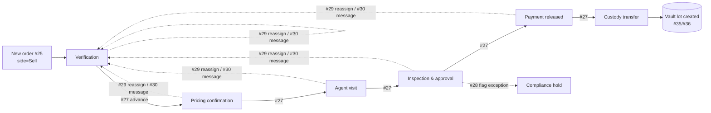
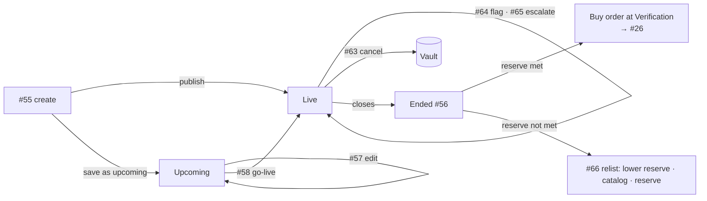

# Mineral Bridge Admin Console — API Endpoint List

**Version:** 1.0 (draft for backend build) · **Date:** 16 Oct 2026 · **Frontend:** `mineral-bridge-admin` v4.2.0
**Base URL:** `{VITE_API_BASE_URL}` → e.g. `https://api.mineralbridge.co.ke/admin/v1`
**Companion document:** [API-CONTRACT.md](API-CONTRACT.md) (request/response schemas, errors, conventions)

This list comes from walking every screen, button, drawer form, toggle, filter
chip and deep-link in the console (`src/modules/**`, `src/layouts/**`). Each
endpoint is tied to the UI action that needs it. The existing stub
`src/lib/endpoints.ts` named 38 paths. This list replaces it and extends it to
cover every interaction.

---

## 1. Total count

### **139 endpoints**

| By method | Count |
|---|---:|
| `GET` | 72 |
| `POST` | 54 |
| `PUT` | 6 |
| `PATCH` | 6 |
| `DELETE` | 1 |
| **Total** | **139** |

| By kind | Count |
|---|---:|
| Read: list / detail / summary / export / stream (`GET`) | 72 |
| Write: create, action, update, delete (`POST` `PUT` `PATCH` `DELETE`) | 67 |
| Of which public or pre-session (auth) | 7 |

### Count by module

| # | Module | Sidebar group | Endpoints | Range |
|---|---|---|---:|---|
| A | Auth & Session | — | 12 | 1–12 |
| B | Shell, Search, Notifications & Lookups | — | 7 | 13–19 |
| C | Overview | Trading | 3 | 20–22 |
| D | Orders (Buy & Sell pipeline, Bulk intake) | Trading | 11 | 23–33 |
| E | Vault & Inventory | Trading | 4 | 34–37 |
| F | Catalog Listings | Trading | 8 | 38–45 |
| G | Pricing & Rates (Rates, Firm offers) | Trading | 7 | 46–52 |
| H | Auctions | Trading | 14 | 53–66 |
| I | LC & Payments | Trading | 7 | 67–73 |
| J | Collaboration (Negotiations, Contracts) | Trade Network | 8 | 74–81 |
| K | Blockchain Monitor | Trade Network | 6 | 82–87 |
| L | Users & Accounts (incl. Tier requests) | People & Trust | 10 | 88–97 |
| M | Verification & Compliance | People & Trust | 4 | 98–101 |
| N | Disputes & Resolution | People & Trust | 6 | 102–107 |
| O | Academy | Content | 5 | 108–112 |
| P | Marketing | Content | 3 | 113–115 |
| Q | Partners & Logistics | Operations | 3 | 116–118 |
| R | Enquiries & Support | Operations | 4 | 119–122 |
| S | Audit Log | Operations | 2 | 123–124 |
| T | Financial & Reporting | Insights | 3 | 125–127 |
| U | Analytics | Insights | 1 | 128 |
| V | Settings (Roles, Platform, Bitcoin) | System | 6 | 129–134 |
| W | Profile | System | 5 | 135–139 |
| | **Total** | | **139** | |

Section 5 lists 10 more endpoints the backend will probably need. No current
screen calls them, so they are not part of the 139.

---

## 2. Screens analysed

| Area | Routes | Screens |
|---|---|---|
| Auth | `/login` `/verify` `/locked` `/signed-out` | Sign-in (password + SSO), 2FA OTP, Lock screen, Signed out |
| Shell | every page | Sidebar badges, global search, theme, notifications bell, account menu, form drawer, toasts |
| Trading | `/overview` `/orders` `/orders/intake` `/orders/:id` `/vault` `/vault/:id` `/listings` `/listings/:id` `/pricing` `/pricing/offers` `/auctions` `/auctions/upcoming` `/auctions/ended` `/auctions/create` `/auctions/live/:id` `/auctions/ended/:id` `/lc` | 17 |
| Trade network | `/collab` `/chain` | 2 |
| People & trust | `/users` `/users/tiers` `/users/:id` `/verification` `/verification/expiry` `/disputes` `/disputes/:id` | 7 |
| Content | `/academy` `/academy/analytics` `/marketing` | 3 |
| Operations | `/partners` `/support` `/support/calls` `/audit` | 4 |
| Insights | `/financial` `/analytics` | 2 |
| System | `/settings` `/settings/platform` `/settings/btc` `/profile` | 4 |

**43 routes. Inventory of interactions:** 31 drawer forms, 63 action buttons,
9 toggle groups, 17 filter-chip groups, 14 sortable tables, 3 edit-gated forms,
6 CSV/export actions and 1 live bid feed.

---

## 3. Endpoint list

**Permission** uses the role matrix modules in `Settings → Role management`
(`Orders, Vault, Pricing, Auctions, Users, Compliance, Content, Financial, Settings`)
at `view` or `edit`. `auth` means any signed-in staff member. Items marked
**†** are modules the matrix does not have yet (see the contract, §9 open questions).

### A. Auth & Session — 12

| # | Method | Path | Purpose | Triggered by | Permission |
|---:|---|---|---|---|---|
| 1 | POST | `/auth/sign-in` | Check email + password, start the 2FA challenge | Login → **Sign in** | public |
| 2 | POST | `/auth/sso/start` | Start staff SSO for a work email and return the IdP redirect | Login → **Continue with staff SSO** | public |
| 3 | POST | `/auth/sso/callback` | Exchange the IdP code and start the 2FA challenge | SSO return URL | public |
| 4 | POST | `/auth/otp/verify` | Verify the 6-digit code, issue the session cookie | Verify → **Verify and open console** | challenge |
| 5 | POST | `/auth/otp/resend` | Send a new OTP to the phone on file | Verify → **Resend code** | challenge |
| 6 | POST | `/auth/password-reset` | Email a reset link | Login → **Forgot password**; Profile → **Change password** | public |
| 7 | POST | `/auth/password-reset/confirm` | Set a new password from the emailed token | Reset link landing (implied) | token |
| 8 | POST | `/auth/refresh` | Extend or rotate the session | Background, before expiry (implied) | auth |
| 9 | POST | `/auth/lock` | Lock the console session on the server | Account menu → **Lock console** | auth |
| 10 | POST | `/auth/unlock` | Re-enter the password to unlock | Locked → **Unlock** | locked session |
| 11 | POST | `/auth/sign-out` | Revoke the session | Account menu → **Sign out** | auth |
| 12 | GET | `/me` | Current staff profile, role, scope and permission matrix | App boot, header, Profile, role gating | auth |

### B. Shell, Search, Notifications & Lookups — 7

| # | Method | Path | Purpose | Triggered by | Permission |
|---:|---|---|---|---|---|
| 13 | GET | `/dashboard/counters` | Sidebar badges and tab counts (Orders 184, KYC 27…) | Sidebar, tab bars | auth |
| 14 | GET | `/search` | Global search across orders, lots, listings, auctions, users, documents, tickets | Header search box | auth (results filtered by role) |
| 15 | GET | `/notifications` | "Needs attention" bell items with target record | Header → bell | auth |
| 16 | POST | `/notifications/{notificationId}/read` | Mark a bell item read | Click a bell item | auth |
| 17 | GET | `/files/{fileId}/url` | Short-lived signed URL for a stored document | Open assay certificate, KYC doc **View**, dispute attachment, order docs | per owning record |
| 18 | GET | `/lookups` | Enumerations: minerals, grades, banks, exception types, amendment types, dispute outcomes, banner placements, partner types, countries | All drawer selects | auth |
| 19 | GET | `/staff` | Staff directory (agents, desk, owners) for pickers | New order agent, **Reassign agent**, ticket owner | auth |

### C. Overview — 3

| # | Method | Path | Purpose | Triggered by | Permission |
|---:|---|---|---|---|---|
| 20 | GET | `/overview/summary` | 5 KPI cards, stage bar, vault value by mineral, desk queues | `/overview` | auth |
| 21 | GET | `/overview/trade-finance` | 6 trade-finance tiles and LC pipeline funnel | `/overview` | auth |
| 22 | GET | `/overview/activity` | Recent activity (last 20) with record references | `/overview` → Recent activity | auth |

### D. Orders — 11

| # | Method | Path | Purpose | Triggered by | Permission |
|---:|---|---|---|---|---|
| 23 | GET | `/orders` | Paginated Buy and Sell pipeline with side/stage filter, search, sort and per-stage counts | `/orders` table, chips, paging | Orders:view |
| 24 | GET | `/orders/export` | CSV of the current filter | Orders → **Export CSV** | Orders:view |
| 25 | POST | `/orders` | Desk-entered order (or draft) | Orders → **New order** drawer | Orders:edit |
| 26 | GET | `/orders/{orderId}` | Detail: pipeline tracker, custody route, facts, documents, action history, counterparty | `/orders/:id` | Orders:view |
| 27 | POST | `/orders/{orderId}/advance` | Move to the next of the 6 stages | **Advance to {next stage}** | Orders:edit |
| 28 | POST | `/orders/{orderId}/exceptions` | Flag an exception (pauses the stage clock, notifies compliance) | **Flag exception** drawer | Orders:edit |
| 29 | PUT | `/orders/{orderId}/assignee` | Reassign the field/desk agent | **Reassign agent** drawer | Orders:edit |
| 30 | POST | `/orders/{orderId}/messages` | SMS + in-app message to the counterparty | **Message counterparty** drawer | Orders:edit |
| 31 | GET | `/orders/intake` | Tier 3 bulk consignments waiting for a desk price | `/orders/intake` | Orders:view |
| 32 | POST | `/orders/intake/{intakeId}/offer` | Send a firm offer at the manual desk price (valid 48 h) | Intake → **Send firm offer** | Pricing:edit |
| 33 | POST | `/orders/intake/{intakeId}/document-requests` | Ask the seller for more documents | Intake → **Request more documents** drawer | Orders:edit |

### E. Vault & Inventory — 4

| # | Method | Path | Purpose | Triggered by | Permission |
|---:|---|---|---|---|---|
| 34 | GET | `/vault/summary` | Stat cards: lots, cost basis, realisable, average days held | `/vault` | Vault:view |
| 35 | GET | `/vault/lots` | Lots with status filter, search and sort. `?allocatable=true` feeds the lot pickers | `/vault`, **Browse unallocated lots**, New listing lot search | Vault:view |
| 36 | GET | `/vault/lots/{lotId}` | Detail: valuation, custody chain, photos, assay certificate, allocation history | `/vault/:id` | Vault:view |
| 37 | POST | `/vault/lots/{lotId}/hold` | Hold the lot in reserve (reason, review date, queue visibility) | Lot → Allocation **Hold in reserve** → **Hold lot** | Vault:edit |

> Lot allocation → **List in Buy catalog** calls #40 `POST /listings`. Allocation
> → **Create auction** calls #55 `POST /auctions`.

### F. Catalog Listings — 8

| # | Method | Path | Purpose | Triggered by | Permission |
|---:|---|---|---|---|---|
| 38 | GET | `/listings/summary` | Stat cards: live, catalog value, sold this month, days to sell | `/listings` | Vault:view |
| 39 | GET | `/listings` | Listings with status filter, search and sort | `/listings` | Vault:view |
| 40 | POST | `/listings` | Publish a vault lot to the fixed-price Buy catalog (or save a draft) | **New listing** drawer; Lot → **Publish listing**; Auction resolution → **Move to fixed-price catalog** | Vault:edit |
| 41 | GET | `/listings/{listingId}` | Detail: sold %, metrics, configuration, source lot, live-rate comparison | `/listings/:id` | Vault:view |
| 42 | PATCH | `/listings/{listingId}` | Save the listing configuration (ask, floor, qty, min parcel, access, featured, description) | **Edit configuration** → Save | Vault:edit |
| 43 | POST | `/listings/{listingId}/pause` | Hide from buyers | **Pause listing** | Vault:edit |
| 44 | POST | `/listings/{listingId}/resume` | Make visible again | **Resume listing** | Vault:edit |
| 45 | POST | `/listings/{listingId}/end` | End the listing and return the remaining lot to vault reserve | **End listing** | Vault:edit |

### G. Pricing & Rates — 7

| # | Method | Path | Purpose | Triggered by | Permission |
|---:|---|---|---|---|---|
| 46 | GET | `/pricing/feed-status` | Market-feed health ("FEED LIVE · SYNCED 2 MIN AGO") | Pricing tab bar | Pricing:view |
| 47 | GET | `/pricing/rates` | Live buy/sell rate table with source filter | `/pricing` | Pricing:view |
| 48 | GET | `/pricing/rates/export` | CSV of the rate table | **Export rates** | Pricing:view |
| 49 | GET | `/pricing/rates/{rateId}/history` | Buy-rate history and period summary (12W / 6M / 1Y) | Click a rate row; range chips | Pricing:view |
| 50 | PUT | `/pricing/rates/{rateId}/source` | Switch between market feed and manual desk override | Source **toggle** | Pricing:edit |
| 51 | GET | `/pricing/offers` | Assay results waiting for a firm-offer decision | `/pricing/offers` | Pricing:view |
| 52 | POST | `/pricing/offers/{offerId}/decision` | Approve, adjust & approve, or hold for review | **Approve offer** / **Adjust & approve** / **Hold for review** | Pricing:edit |

### H. Auctions — 14

| # | Method | Path | Purpose | Triggered by | Permission |
|---:|---|---|---|---|---|
| 53 | GET | `/auctions` | `?status=live|upcoming|ended`, flag filter, search and sort, plus tab counts | Live / Upcoming / Ended tabs | Auctions:view |
| 54 | GET | `/auctions/eligible-lots` | Vault lots that can go to auction, with suggested start, reserve and increment | Create auction → step 1 | Auctions:view |
| 55 | POST | `/auctions` | Create an auction: publish now or save as upcoming | **Publish auction** / **Save as upcoming**; Lot → **Continue to auction form**; Listing → **Move to auction** | Auctions:edit |
| 56 | GET | `/auctions/{auctionId}` | Detail for the monitor (leader, reserve, risk signal) or resolution (outcome, winner, buy order, escrow) | `/auctions/live/:id`, `/auctions/ended/:id` | Auctions:view |
| 57 | PATCH | `/auctions/{auctionId}` | Edit an upcoming auction's terms | Upcoming → **Edit** | Auctions:edit |
| 58 | POST | `/auctions/{auctionId}/go-live` | Open an upcoming auction now | Upcoming → **Go live** | Auctions:edit |
| 59 | GET | `/auctions/{auctionId}/bids` | Bid feed, newest first, with linked-account markers | Monitor bid list | Auctions:view |
| 60 | GET | `/auctions/{auctionId}/bids/stream` | Live bid feed (Server-Sent Events) | Monitor (live) | Auctions:view |
| 61 | POST | `/auctions/{auctionId}/pause` | Suspend bidding | **Pause auction** | Auctions:edit |
| 62 | POST | `/auctions/{auctionId}/resume` | Resume bidding | **Resume auction** | Auctions:edit |
| 63 | POST | `/auctions/{auctionId}/cancel` | Cancel and return the lot to the vault | **Cancel auction** | Auctions:edit |
| 64 | POST | `/auctions/{auctionId}/flags` | Flag suspicious activity (notifies compliance, bids stay live) | **Flag suspicious activity** | Auctions:edit |
| 65 | POST | `/auctions/{auctionId}/escalate` | Open a compliance dispute for this auction | **Escalate to compliance** | Auctions:edit |
| 66 | POST | `/auctions/{auctionId}/relist` | After close: relist at a lower reserve, move to catalog, or return to reserve | Resolution → Relist options (3 buttons) | Auctions:edit |

### I. LC & Payments — 7

| # | Method | Path | Purpose | Triggered by | Permission |
|---:|---|---|---|---|---|
| 67 | GET | `/letters-of-credit/summary` | Stat cards: open, expiring ≤ 7 d, with discrepancies, paid this month | `/lc` | Financial:view |
| 68 | GET | `/letters-of-credit` | LC table with stage, expiring and discrepancy filters | `/lc`; Overview LC funnel stage click | Financial:view |
| 69 | POST | `/letters-of-credit` | Request a new LC against a signed contract | **Request LC** drawer | Financial:edit |
| 70 | GET | `/letters-of-credit/{lcId}` | Terms, document check, discrepancies, linked order | Row click → detail panel; Contracts → open LC | Financial:view |
| 71 | POST | `/letters-of-credit/{lcId}/discrepancies/{discrepancyId}/resolve` | Mark a bank discrepancy resolved | **Mark resolved** | Financial:edit |
| 72 | POST | `/letters-of-credit/{lcId}/release` | Release payment (only at *Docs presented* with 0 discrepancies) | **Release payment** | Financial:edit |
| 73 | POST | `/letters-of-credit/{lcId}/amendments` | Request an amendment (expiry, amount, shipment date…) | **Request amendment** drawer | Financial:edit |

### J. Collaboration — 8

| # | Method | Path | Purpose | Triggered by | Permission |
|---:|---|---|---|---|---|
| 74 | GET | `/negotiations/summary` | Stat cards: active, contracts QTD, time to agreement, acceptance rate | `/collab` | Orders:view |
| 75 | GET | `/negotiations` | Miner ↔ trader negotiations with status filter | `/collab` | Orders:view |
| 76 | GET | `/negotiations/{negotiationId}` | Offer history by round | Row click → panel | Orders:view |
| 77 | POST | `/negotiations/{negotiationId}/mediations` | Send a mediated price to both parties | **Mediate with suggested price** drawer | Orders:edit |
| 78 | POST | `/negotiations/{negotiationId}/reminders` | Nudge the party whose turn it is | **Send reminder** | Orders:edit |
| 79 | POST | `/negotiations/{negotiationId}/contract` | Turn agreed terms into a contract and send it for e-signature | **Convert to contract** | Orders:edit |
| 80 | GET | `/contracts` | Signed contracts with linked LC (`?q=` also feeds the LC contract picker) | Contracts signed list; Request LC → contract search | Orders:view |
| 81 | GET | `/network/rankings` | Top-rated miners / traders (`?role=miner|trader`) | Ranking cards | Orders:view |

### K. Blockchain Monitor — 6

| # | Method | Path | Purpose | Triggered by | Permission |
|---:|---|---|---|---|---|
| 82 | GET | `/chain/network-status` | Status cards for the passport ledger, anchor service and nodes | `/chain` | Financial:view |
| 83 | GET | `/chain/anchors/latest` | Latest Bitcoin anchor (block, confirmations, merkle root, tx, batch, next batch) | `/chain` anchor card; **View in explorer** uses `explorerUrl` | Financial:view |
| 84 | GET | `/chain/passports/stats` | Passports minted per week and total | Passports chart | Financial:view |
| 85 | GET | `/chain/events` | On-chain event feed with type filter (poll every 15 s) | Event table | Financial:view |
| 86 | POST | `/chain/passports/verify` | Check a passport ID or hash against the latest anchor | **Verify a passport** drawer | Financial:view |
| 87 | POST | `/chain/anchors` | Queue a manual anchor into the next batch | **Anchor now** | Financial:edit |

### L. Users & Accounts — 10

| # | Method | Path | Purpose | Triggered by | Permission |
|---:|---|---|---|---|---|
| 88 | GET | `/users` | Accounts with tier/status filter, search and sort (also the counterparty picker) | `/users`; New order counterparty search; New ticket user search | Users:view |
| 89 | GET | `/users/export` | CSV of the account list | **Export list** | Users:view |
| 90 | GET | `/users/{userId}` | Profile card: tier, status, organisation, phone, disputes | `/users/:id` | Users:view |
| 91 | GET | `/users/{userId}/orders` | Order history and lifetime value | User → Order history | Users:view |
| 92 | GET | `/users/{userId}/tickets` | Support ticket history | User → Support ticket history | Users:view |
| 93 | GET | `/users/{userId}/documents` | Linked KYC documents with expiry | User → Linked documents | Users:view |
| 94 | POST | `/users/{userId}/messages` | In-app + SMS message | **Message user** drawer | Users:edit |
| 95 | POST | `/tier-requests` | Raise a tier change for compliance review | User → **Change tier · compliance review** | Users:edit |
| 96 | GET | `/tier-requests` | Pending tier change requests | `/users/tiers` | Users:view |
| 97 | POST | `/tier-requests/{requestId}/decision` | Approve or deny | **Approve** / **Deny** | Compliance:edit |

### M. Verification & Compliance — 4

| # | Method | Path | Purpose | Triggered by | Permission |
|---:|---|---|---|---|---|
| 98 | GET | `/compliance/kyc` | KYC queue with tier filter and `overdueSla` (SLA view) | `/verification`; **SLA view** | Compliance:view |
| 99 | GET | `/compliance/kyc/{kycId}` | Submission with the documents required for its tier | Expand a KYC card | Compliance:view |
| 100 | POST | `/compliance/kyc/{kycId}/decision` | Approve tier, request resubmission, or reject with reason | **Approve tier** / **Request resubmission** / **Reject with reason** | Compliance:edit |
| 101 | GET | `/compliance/documents` | Document expiry monitor (expired, < 30 d, < 90 d, in review) | `/verification/expiry` | Compliance:view |

### N. Disputes & Resolution — 6

| # | Method | Path | Purpose | Triggered by | Permission |
|---:|---|---|---|---|---|
| 102 | GET | `/disputes` | Dispute queue with status filter and sort | `/disputes` | Compliance:view |
| 103 | GET | `/disputes/{disputeId}` | Header, linked record, counterparty, attachments | `/disputes/:id` | Compliance:view |
| 104 | GET | `/disputes/{disputeId}/messages` | Conversation thread | Dispute conversation | Compliance:view |
| 105 | POST | `/disputes/{disputeId}/messages` | Reply to the counterparty | Reply box → **Send** | Compliance:edit |
| 106 | POST | `/disputes/{disputeId}/resolution` | Record outcome, settlement adjustment and note | **Record resolution** | Compliance:edit |
| 107 | POST | `/disputes/{disputeId}/escalate` | Escalate to compliance hold | **Escalate to compliance** | Compliance:edit |

### O. Academy — 5

| # | Method | Path | Purpose | Triggered by | Permission |
|---:|---|---|---|---|---|
| 108 | GET | `/academy/categories` | 6 categories with their courses | `/academy` Course CMS | Content:view |
| 109 | POST | `/academy/courses` | Create a course (draft) | **New course** drawer | Content:edit |
| 110 | PATCH | `/academy/courses/{courseId}` | Edit a course or toggle its certified track | **Edit** drawer; **Certified track** toggle | Content:edit |
| 111 | POST | `/academy/courses/{courseId}/lessons` | Add a lesson (or draft) | **+ Lesson** drawer; category **Add lesson** | Content:edit |
| 112 | GET | `/academy/analytics` | Enrolments, completion per course split by tier, certificates | `/academy/analytics` | Content:view |

### P. Marketing — 3

| # | Method | Path | Purpose | Triggered by | Permission |
|---:|---|---|---|---|---|
| 113 | GET | `/marketing/banners` | Banners, promo cards, category imagery | `/marketing` | Content:view |
| 114 | POST | `/marketing/banners` | Create a banner (inactive until toggled) | **New banner** drawer | Content:edit |
| 115 | PATCH | `/marketing/banners/{bannerId}` | Edit a banner or toggle live/offline | **Edit** drawer; live **toggle** | Content:edit |

### Q. Partners & Logistics — 3

| # | Method | Path | Purpose | Triggered by | Permission |
|---:|---|---|---|---|---|
| 116 | GET | `/partners` | Carriers, inspection hubs and labs with type filter | `/partners` | Orders:view † |
| 117 | POST | `/partners` | Add a partner (starts in *Onboarding*) | **Add partner** drawer | Orders:edit † |
| 118 | PATCH | `/partners/{partnerId}` | Update status, contact, capacity, internal note | **Manage** drawer | Orders:edit † |

### R. Enquiries & Support — 4

| # | Method | Path | Purpose | Triggered by | Permission |
|---:|---|---|---|---|---|
| 119 | GET | `/support/tickets` | Ticket queue with status filter and sort | `/support` | Support:view † |
| 120 | POST | `/support/tickets` | Log a phone/WhatsApp enquiry as a ticket | **New ticket** drawer | Support:edit † |
| 121 | GET | `/support/tickets/{ticketId}` | Ticket detail and notes | Ticket row click | Support:view † |
| 122 | GET | `/support/calls` | Call history | `/support/calls` | Support:view † |

### S. Audit Log — 2

| # | Method | Path | Purpose | Triggered by | Permission |
|---:|---|---|---|---|---|
| 123 | GET | `/audit-log` | Attributed admin actions with category filter, search, sort and before/after values | `/audit`; Overview **Full log** | Settings:view † |
| 124 | POST | `/audit-log/exports` | Queue an async export, emailed when ready | **Export log** | Settings:view † |

### T. Financial & Reporting — 3

| # | Method | Path | Purpose | Triggered by | Permission |
|---:|---|---|---|---|---|
| 125 | GET | `/settlements/summary` | Escrow cards: held, released this week, on hold, fee revenue | `/financial` | Financial:view |
| 126 | GET | `/settlements` | Settlement ledger with status filter and period | `/financial` ledger; period selector | Financial:view |
| 127 | GET | `/settlements/statement` | Monthly statement export (CSV) | **Export statement** | Financial:view |

### U. Analytics — 1

| # | Method | Path | Purpose | Triggered by | Permission |
|---:|---|---|---|---|---|
| 128 | GET | `/analytics/summary` | KPIs, GMV by mineral, tier distribution, auction trend, academy engagement, stage bottlenecks | `/analytics` | Financial:view † |

### V. Settings — 6

| # | Method | Path | Purpose | Triggered by | Permission |
|---:|---|---|---|---|---|
| 129 | GET | `/settings/roles` | Role × module permission matrix with seats | `/settings`; Profile **View role matrix** | Settings:view |
| 130 | PUT | `/settings/roles/permissions` | Save matrix changes (one batch per edit session) | **Edit permissions** → Save | Settings:edit |
| 131 | GET | `/settings/platform` | Platform thresholds | `/settings/platform` | Settings:view |
| 132 | PUT | `/settings/platform` | Save thresholds | **Edit configuration** → Save | Settings:edit |
| 133 | GET | `/settings/btc/countries` | Bitcoin settlement by country (regulation, rail, limit, enabled) | `/settings/btc` | Settings:view |
| 134 | PUT | `/settings/btc/countries` | Save enabled/disabled per country | **Edit** → toggles → Save | Settings:edit |

### W. Profile — 5

| # | Method | Path | Purpose | Triggered by | Permission |
|---:|---|---|---|---|---|
| 135 | PATCH | `/me` | Save name, phone, desk | **Edit profile** → **Save profile** | auth |
| 136 | GET | `/me/sessions` | Active sessions by device | Profile → Active sessions | auth |
| 137 | DELETE | `/me/sessions/{sessionId}` | Revoke a session | **Revoke** | auth |
| 138 | GET | `/me/notification-preferences` | Notification toggles | Profile → Notifications | auth |
| 139 | PUT | `/me/notification-preferences` | Save notification toggles | Notification **toggle** | auth |

> Profile → **Change password** reuses #6 `POST /auth/password-reset`.

---

## 4. User flows → endpoints

Each flow below is an end-to-end business process in the console, with the
endpoints it calls in order.

### 4.1 Staff sign-in, lock and sign-out
```
Login ──#1 sign-in──▶ Verify OTP ──#4 verify──▶ Console (#12 /me, #13 counters)
  └─#2/#3 SSO ─────────┘     └─#5 resend
Console ──#9 lock──▶ Locked ──#10 unlock──▶ Console
Console ──#11 sign-out──▶ Signed out
```

### 4.2 Sell order: miner sells into the vault

Pricing confirmation pulls on assay results → **Firm offer approvals** (#51 → #52).
Tier 3 bulk consignments go through **Bulk intake** first (#31 → #32 firm offer,
or #33 request documents).

### 4.3 Vault allocation: where a lot goes
```
Lot detail #36 ─┬─ List in Buy catalog ──#40 POST /listings──▶ Listing live (#41…#45)
                ├─ Create auction ──#54 eligible lots──#55 POST /auctions──▶ Live/Upcoming
                └─ Hold in reserve ──#37 hold
```

### 4.4 Buy side: catalog listing
```
#39 list ─▶ #41 detail ─┬─ #42 save configuration
                        ├─ #43 pause / #44 resume
                        ├─ Move to auction ─▶ #55 (sourceListingId) ─▶ listing auto-ended
                        └─ #45 end ─▶ lot back to vault reserve
Buyer purchase (in buyer app) ─▶ Buy order appears in #23 at Verification
```

### 4.5 Auction lifecycle

Monitor uses #56 + #59 + #60 (SSE stream).

### 4.6 Trade finance: negotiation → contract → LC → payment
```
#75/#76 negotiation ─┬─ #77 mediate / #78 remind
                     └─ Terms agreed ─#79 convert to contract─▶ #80 contracts
#69 request LC (contract) ─▶ Requested ─▶ Issued ─▶ Shipped ─▶ Docs presented
   ├─ #71 resolve discrepancy (each)    ├─ #73 amendment
   └─ #72 release payment (0 discrepancies) ─▶ Paid ─▶ settlement in #126, LC event in #85
```

### 4.7 Compliance: KYC, tier changes, document expiry
```
#98 KYC queue ─▶ #99 expand ─▶ #17 view doc ─▶ #100 approve | resubmit | reject
User #90 ─▶ #95 change tier ─▶ #96 tier requests ─▶ #97 approve | deny
#101 expiry monitor (feeds bell #15 and Overview activity #22)
```

### 4.8 Disputes
```
Raised by: auction escalate #65 · order exception #28 · counterparty (app)
#102 queue ─▶ #103 detail ─▶ #104 thread ─▶ #105 reply
             ├─ #107 escalate to compliance hold
             └─ #106 record resolution (outcome + settlement adjustment) ─▶ #126 ledger
```

### 4.9 Content, operations and system
- **Academy:** #108 → #109 new course / #110 edit or certify / #111 add lesson; #112 analytics
- **Marketing:** #113 → #114 new banner → #115 toggle live / edit
- **Partners:** #116 → #117 add (Onboarding) → #118 manage (Active / Suspended)
- **Support:** #119 → #120 new ticket / #121 open; #122 calls
- **Settings:** edit-gated saves #130, #132, #134 (each writes the audit log)
- **Profile:** #135 save, #137 revoke session, #139 notification toggles

### 4.10 Cross-cutting navigation (no extra endpoints)
Overview KPI cards, desk queues, LC funnel stages, activity rows, bell items,
audit rows and chain events deep-link to records by ID. The frontend resolves
the route (`useJump`). The backend only has to return a `ref` (`{ type, id }`)
on each item. See the contract, §3.6.

---

## 5. Recommended extras (not counted)

No current screen calls these, but the audit log, role scopes or data model
point to them. Add them when the matching UI is built.

| Method | Path | Why |
|---|---|---|
| POST | `/vault/lots` | Audit log "Created vault lot" and the Data Entry Clerk scope "Vault intake" |
| PATCH | `/vault/lots/{lotId}` | Audit log "Updated lot location" |
| POST | `/vault/lots/{lotId}/release` | Lot hold copy says it stays held "until you release it" |
| PUT | `/orders/{orderId}/carrier` | Audit log "Changed carrier assignment" |
| PATCH | `/support/tickets/{ticketId}` | Audit log "Reassigned ticket"; ticket status changes |
| POST | `/support/tickets/{ticketId}/notes` | Working a ticket after it is opened |
| POST | `/users` | Data Entry Clerk scope "account creation" |
| POST | `/files` | Upload banner images, lesson media, evidence (multipart) |
| POST / DELETE | `/settings/roles`, `/staff/invitations` | Creating roles and onboarding staff seats |
| GET | `/chain/events/stream` | SSE instead of polling for the "LIVE FEED" |

---

## 6. Mapping to the current `src/lib/endpoints.ts`

| Existing key | Path today | In this list |
|---|---|---|
| `auth.signIn / sso / verifyOtp / resendOtp / unlock / signOut / passwordReset` | `/auth/*` | #1, #2, #4, #5, #10, #11, #6 (`sso` → `sso/start`) |
| `orders.*` (9) | `/orders…` | #23–#33 (`flag` → `/exceptions`, `reassign` → `PUT /assignee`) |
| `vault.allocate` | `/vault/lots/{id}/allocation` | **Changed** → #37 `/hold` (catalog → #40, auction → #55) |
| `pricing.override` | `/pricing/rates/{key}/override` | **Changed** → #50 `PUT /pricing/rates/{rateId}/source` |
| `auctions.bids` | `/auctions/{id}/bids` | #59 (+ #60 stream) |
| `lc.release` | `/letters-of-credit/{id}/release` | #72 |
| `chain.anchor / verifyPassport` | `/chain/anchor`, `/chain/passports/verify` | #87 (now `/chain/anchors`), #86 |
| `users.tierRequests` | `/users/tier-requests` | **Changed** → #96 `/tier-requests` (avoids clashing with `/users/{userId}`) |
| `compliance.documents` | `/compliance/documents` | #101 |
| `audit.export` | `/audit-log/export` | **Changed** → #124 `POST /audit-log/exports` (async) |
| `financial.ledger / statement` | `/settlements…` | #126, #127 |
| `settings.*`, `profile.*` | | #129–#139 |
